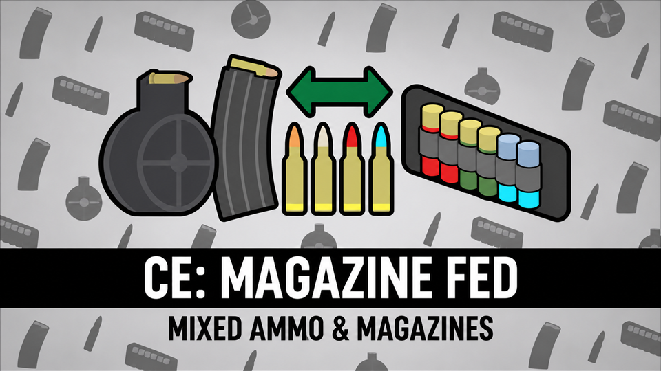

# Combat Extended - Magazine Fed



为 RimWorld **Combat Extended (CE)** 开发的实体弹匣供弹与混装弹种顺序编排模组（支持 RimWorld **1.6** 与 **1.7**）。

## 核心特性

1. **实体弹匣供弹与战术换弹**
   - 弹匣供弹武器改为通过背包中的实体弹匣（`CEMF_Magazine`）进行换弹，弹匣容量由武器载弹量定义，同口径 + 同容量的弹匣通用。
   - 战术换弹自动将枪内半满弹匣原样退回背包保留余弹与弹序；空弹匣按小人配置自动免费配发（无需工作台制造）。
   - 战斗中若所有弹匣打空但仍有散弹，禁止直接散弹装枪，小人会在现场慢速将散弹压入弹匣后再装填。

2. **同弹匣混装与逐发顺序射击**
   - 同一弹匣可自由混装同口径不同弹种（如 FMJ / AP / HP / HE / 燃烧弹 / 曳光弹 / EMP 等），精确控制每一发的发射顺位（第 1 发 → 第 N 发）。
   - 射击（含点射/连发中的每一发）自动按弹匣内实际弹序依次射出对应弹头；武器弹药状态栏实时展示混装弹种色带与下一发提示。

3. **可视化弹匣与供弹方案管理界面**
   - 选中携带枪械的殖民者点击 **「弹匣方案」** 按钮即可打开管理窗口（支持左侧快速切换所有殖民者、顶部按武器分页）。
   - 独立管理每位殖民者的携带弹匣总数、每个弹匣槽位的目标方案与实装双色带对比，支持逐发点击/拖动绘制、顺序分段、循环交错（如 `3:1` 穿甲/曳光）、弹匣间复制同步及殖民地预设库。
   - 界面与弹匣贴图均参考 Combat Extended / RimWorld 原版美术风格制作。

4. **闲时自动压弹**
   - 殖民者与已启用弹匣的机械体在闲暇时自动按方案整理与压填弹匣（优先使用背包散弹，不足自动前往储藏区取弹），也可直接点击底部 **「立即压弹」** 按钮（支持多选）或在管理界面点击 **「立即压装弹匣」** 手动指派。

5. **单发装填多发弹仓武器支持（含战术侧装 / Port Load）**
   - 弓弩与单发武器保留 CE 原版装填逻辑。
   - 泵动霰弹枪、转轮、内置弹仓等逐发装填武器仍使用散弹装填，同时提供与弹匣一致的可视化弹种顺序编排界面。
   - 支持 **侧装（Port Load）**：选中携带单发装填武器的小人点击底部「侧装」按钮，可临时选取背包中的一发指定兼容子弹直接装入第 1 顺位（下一发立即射出）；弹仓已满时会自动退回当前第 1 发子弹到背包后再装入，耗时固定为 1.0x 单发装弹时间。

6. **模组设置与兼容**
   - 可在游戏模组设置中切换适用范围（默认「仅玩家殖民地小人」/「全阵营含敌方与中立 NPC」）、机械体开关（默认关闭）、自动压弹优先级（仅闲时 / 优先于常规工作 / 仅手动）与压弹速度。
   - **武器供弹模式自定义**：设置页新增「武器供弹模式」标签，可按 Mod 来源、供弹模式与关键词筛选全部多发 CE 武器，单独或批量切换为「默认 / 弹匣供弹 / 单发弹仓 / 原版」并自动换算装弹时间（无需重启）。
   - 兼容 CE 装备方案（Loadout），不会误丢弹匣，并将弹匣内子弹计入弹药统计。

## 面向 Mod 作者的 XML 兼容接口

第三方武器 Mod 无需引用本 Mod 的 C# 程序集，即可通过 `CE_MagazineFed.FeedModeExtension` 为武器声明默认供弹方式。

### 优先级规则

**玩家 Mod 设置覆盖 > Mod 作者 XML `FeedModeExtension` > CE 原版 `reloadOneAtATime` 自动推断**

### 字段说明

| 字段 | 类型 | 默认值 | 说明 |
| --- | --- | --- | --- |
| `defaultFeedMode` | 枚举 | `Auto` | 可选值：`Auto`（按 CE 自动推断）、`MagazineFed`（弹匣供弹）、`SingleLoad`（单发弹仓）、`VanillaCE`（交回 CE 原版处理） |
| `autoAdjustReloadTime` | `bool` | `true` | 当 `defaultFeedMode` 与 CE 原版 `reloadOneAtATime` 不同时，是否自动同步 `reloadOneAtATime` 并按公式换算 `reloadTime`（单发→弹匣：`原时间 × 弹容 × 0.9`；弹匣→单发：`原时间 / 弹容`，保留 1 位小数）。设为 `false` 则保持原版换弹时间与方式不变 |
| `overrideReloadTime` | `float` | `-1` | 可选，大于 `0` 时直接指定换弹时间（秒，保留 1 位小数），优先级高于 `autoAdjustReloadTime` |

### 方式一：直接在 `ThingDef` 中使用 `MayRequire`（最简推荐，按 `packageId` 软兼容）

```xml
<modExtensions>
  <li MayRequire="kuwa.ce.magazinefed" Class="CE_MagazineFed.FeedModeExtension">
    <defaultFeedMode>SingleLoad</defaultFeedMode>
    <autoAdjustReloadTime>true</autoAdjustReloadTime>
  </li>
</modExtensions>
```

### 方式二：通过 `Patches/` 补丁注入（或配合 `LoadFolders.xml` 的 `IfModActive="kuwa.ce.magazinefed"`）

```xml
<?xml version="1.0" encoding="utf-8"?>
<Patch>
  <Operation Class="PatchOperationFindMod">
    <mods>
      <li>Combat Extended - Magazine Fed</li>
    </mods>
    <match Class="PatchOperationConditional">
      <xpath>Defs/ThingDef[defName="YourMod_DoubleBarrelShotgun"]/modExtensions</xpath>
      <match Class="PatchOperationAdd">
        <xpath>Defs/ThingDef[defName="YourMod_DoubleBarrelShotgun"]/modExtensions</xpath>
        <value>
          <li Class="CE_MagazineFed.FeedModeExtension">
            <defaultFeedMode>SingleLoad</defaultFeedMode>
            <autoAdjustReloadTime>true</autoAdjustReloadTime>
          </li>
        </value>
      </match>
      <nomatch Class="PatchOperationAdd">
        <xpath>Defs/ThingDef[defName="YourMod_DoubleBarrelShotgun"]</xpath>
        <value>
          <modExtensions>
            <li Class="CE_MagazineFed.FeedModeExtension">
              <defaultFeedMode>SingleLoad</defaultFeedMode>
              <autoAdjustReloadTime>true</autoAdjustReloadTime>
            </li>
          </modExtensions>
        </value>
      </nomatch>
    </match>
  </Operation>
</Patch>
```

## 依赖与加载顺序

- `brrainz.harmony` (Harmony)
- `CETeam.CombatExtended` (Combat Extended)
- `kuwa.ce.magazinefed` (**Combat Extended - Magazine Fed**，置于上述模组之后)

## 从源码构建

项目位于 `Source/CE_MagazineFed.csproj`，多目标支持 `net48`（RimWorld 1.6）与 `net10.0`（RimWorld 1.7）：

```powershell
dotnet build Source/CE_MagazineFed.csproj -c Release
```
